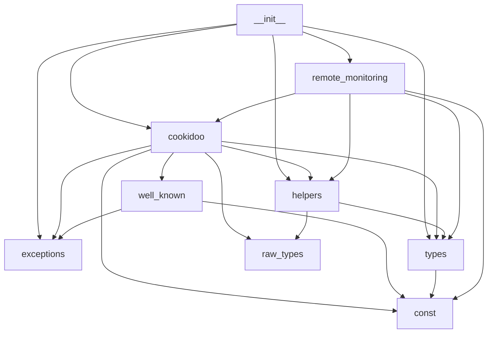
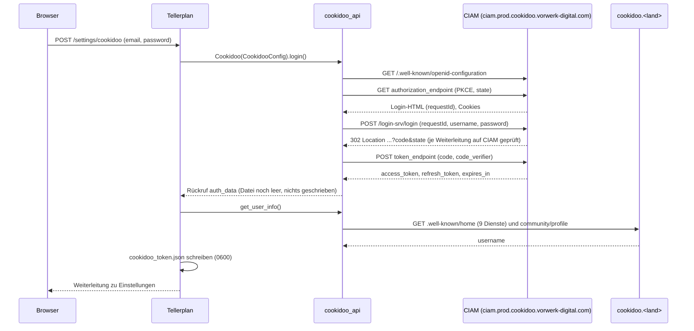
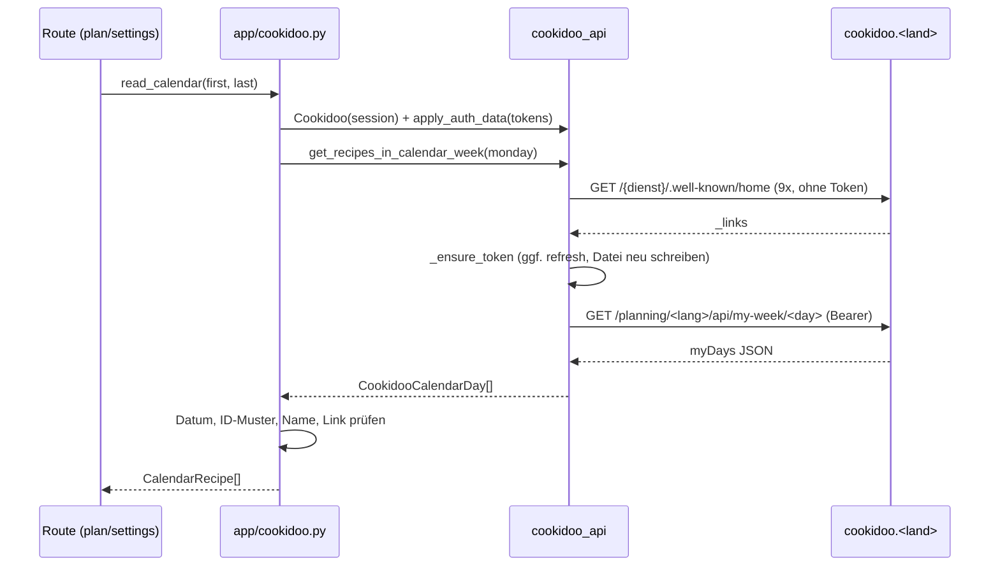

# Cookidoo-API: Architektur und Datenströme

Grundlage für das Sicherheits-Code-Review der Bibliothek `cookidoo-api` 0.19.0 und ihrer Nutzung durch Tellerplan. Gehört zu [[Cookidoo-Sync]] (Abschnitt „Sicherheitsprüfung der Bibliothek“). Stand: 2026-11-13.

Schreibweise der Belege: `lib/X.py:Lnn` = `tellerplan/app/.venv/Lib/site-packages/cookidoo_api/X.py`; `app/X.py:Lnn` = `tellerplan/app/X.py`. Nur was im Code belegt ist; Bewertungen stehen im Abschnitt „Ergebnis der Sicherheitsprüfung“ und in [[Cookidoo-Sync]].

## 1. Modulübersicht der Bibliothek

Rund 6.200 Zeilen, reiner Python-Quelltext, dazu `localization.json` (Land/Sprache/URL) und `py.typed`. Abhängigkeiten laut METADATA: `aiohttp~=3.13`, `firebase-messaging~=0.4`, `aiofiles~=25.1`, `isodate~=0.7.2`.

| Datei | Zeilen | Zweck und wichtigste Teile |
| --- | --- | --- |
| `lib/__init__.py` | 117 | `__version__ = "0.19.0"` (L3); Re-Exports. Importiert `.cookidoo` (L5), `.exceptions` (L6-14), `.helpers` (L15-20), `.remote_monitoring` (L21), `.types` (L22ff); `__all__` ab L64 |
| `lib/const.py` | 137 | Nur Konstanten: Hosts, OAuth-Kennungen, Pfadvorlagen, Accept-Header, Firebase-Kennungen (Details unten) |
| `lib/cookidoo.py` | 3164 | Klasse `Cookidoo` (L128): HTTP-Kern `_request_json` (L198-318), Token-Handling, Login, alle API-Methoden |
| `lib/helpers.py` | 931 | JSON → Typen (`cookidoo_calendar_day_from_json` L832-876, `cookidoo_user_info_from_json` L99), URL-Bau (`_construct_recipe_url` L307-334), Lokalisierung (`get_localization_options` L896-901, `__get_localization_options` L879-893 liest lokale Datei per `aiofiles`), `cooking_activity_from_push` (L178) |
| `lib/raw_types.py` | 402 | `TypedDict`s der Roh-JSON-Antworten, z. B. `CalenderDayRecipeJSON` L358, `CalendarDayJSON` L367. Nur Typen, kein Code mit Wirkung |
| `lib/types.py` | 828 | Datenklassen: `CookidooLocalizationConfig` L106, `CookidooConfig` L115 (hält `email`, `password`), `CookidooAuthData` L220, `CookidooCalendarDayRecipe` L776, `CookidooCalendarDay` L809, `CookidooUserInfo` L148; Thermomix-Enums |
| `lib/exceptions.py` | 29 | `CookidooException` und Unterklassen (Auth, Config, Parse, Request, Response, Unavailable) |
| `lib/remote_monitoring.py` | 281 | `CookidooRemoteMonitoring` (L108): Firebase-Push für Thermomix-Kochstatus; `start` L173, `stop` L234 |
| `lib/well_known.py` | 287 | Endpunkt-Erkennung über `.well-known/home`: `ENDPOINT_RELS` L84-119, `_normalize_href` L144-181, `_fetch_service_links` L186-217, `resolve_endpoint_paths` L220-287 |

### Importbeziehungen

Belege: `lib/cookidoo.py:L3-114`, `lib/helpers.py:L14-67`, `lib/well_known.py:L27-54`, `lib/types.py:L8`, `lib/remote_monitoring.py:L26-37`.

Fremdpakete je Modul:

| Modul | Fremdpakete |
| --- | --- |
| `cookidoo.py` | `aiohttp` (`ClientError`, `ClientSession`, L23), `yarl` (`URL`, L24) |
| `helpers.py` | `aiofiles` (L11), `isodate` (L12) |
| `well_known.py` | `aiohttp` (L24), `yarl` (L25) |
| `remote_monitoring.py` | `aiohttp` (L23), `firebase_messaging` (`FcmPushClient`, `FcmRegisterConfig`, L24) |
| `firebase_messaging` (Fremdpaket 0.4.5) | `cryptography`, `google.protobuf`, `http_ece`, `ssl`, `aiohttp` (`fcmpushclient.py:L7-22`, `fcmregister.py:L14-17`) |

Wichtige Konstanten in `lib/const.py`:

| Konstante | Wert | Zeile |
| --- | --- | --- |
| `CIAM_BASE_URL` | `https://ciam.prod.cookidoo.vorwerk-digital.com` | L23 |
| `CIAM_LOGIN_SRV_URL` | `{CIAM_BASE_URL}/login-srv/login` | L24 |
| `OIDC_DISCOVERY_URL` | `{CIAM_BASE_URL}/.well-known/openid-configuration` | L25 |
| `OAUTH_CLIENT_ID`, `OAUTH_REDIRECT_URI` | `mobile-android`, `com.vorwerk.cookidoo://code-grant` | L47-48 |
| `OAUTH_SCOPE` | `openid profile email offline offline_access` | L49 |
| `TOKEN_EXPIRY_MARGIN_S` | 300 | L51 |
| `LOGIN_HEADERS` | Browser-`User-Agent` (Chrome 125), nur für Login/Discovery | L16-21 |
| Kalenderpfade | `planning/{language}/api/my-week/{day}`, `.../api/my-day`, `.../api/my-day/{day}/recipes/{recipe}` | L133-137 |
| `MOBILE_HOME_PATH`, `RMI_*` | Fernüberwachung (nicht von Tellerplan genutzt) | L85-95 |
| `FCM_*` | Firebase-Projektkennungen der Android-App | L104-107 |

## 2. Von Tellerplan genutzte Funktionen

Tellerplan importiert genau sechs Namen (`app/cookidoo.py:L37-44`): `Cookidoo`, `CookidooAuthData`, `CookidooAuthException`, `CookidooConfig`, `CookidooException`, `get_localization_options`. Außerdem `aiohttp` (`ClientSession`, `ClientTimeout`, `CookieJar`, `ClientError`, L36). Weitere Nutzer der Bibliothek: `tools/cookidoo_probe.py` (Rechner-Skript, nicht im Add-on) und `tests/test_cookidoo.py`.

| Tellerplan-Aufruf | Aufrufstelle | Bibliothek | Durchlaufene Helfer |
| --- | --- | --- | --- |
| `Cookidoo(session, config, on_auth_data_update=…)` | `app/cookidoo.py:L243` | `lib/cookidoo.py:L145-182` | – |
| `apply_auth_data(CookidooAuthData(**tokens))` | `app/cookidoo.py:L245` | `lib/cookidoo.py:L467-476` (kein Netz) | – |
| `login()` | `app/cookidoo.py:L100` | `lib/cookidoo.py:L478-555` | `_assert_oauth_client` L802, `_discovery` L642, `_pkce_pair` L792, `_extract_request_id` L826, `_submit_credentials` L652, `_assert_ciam_origin` L698, `_check_login_page_status` L712, `_exchange_code` L719, `_apply_tokens` L741, `_notify_auth_data_update` L759 |
| `get_user_info()` | `app/cookidoo.py:L101` | `lib/cookidoo.py:L841-873` | `_ensure_endpoints` L364, `_request_json` L198, `cookidoo_user_info_from_json` (`lib/helpers.py:L99`) |
| `auth_data` (Property) | `app/cookidoo.py:L102` | `lib/cookidoo.py:L430-439` | – |
| `get_recipes_in_calendar_week(monday)` | `app/cookidoo.py:L125` | `lib/cookidoo.py:L2841-2898` | `_ensure_endpoints`, `_path` L411, `_request_json`, `_ensure_mapping` L328, `_parse_result` L346, `cookidoo_calendar_day_from_json` (`lib/helpers.py:L832`) |
| `add_recipes_to_calendar(day, ids)` | `app/cookidoo.py:L143` | `lib/cookidoo.py:L2957-3003` | wie oben |
| `remove_recipe_from_calendar(day, id)` | `app/cookidoo.py:L151` | `lib/cookidoo.py:L3005-3055` | wie oben, `_empty_calendar_day` L416 |
| `get_localization_options(country, language)` | `app/cookidoo.py:L251` | `lib/helpers.py:L896-901` → `L879-893` | liest `localization.json` (`lib/helpers.py:L71`) per `aiofiles` |
| Token-Erneuerung (indirekt) | – (kein direkter Aufruf) | `_request_json` L250 → `_ensure_token` L776-790 → `refresh` L557-606 | `_is_token_expiring` L772, `_discovery`, `_apply_tokens`, Rückruf |
| Rückruf `on_auth_data_update` | `app/cookidoo.py:L243` → `_tokens_renewed` L211-214 | `lib/cookidoo.py:L759-770` | Ausnahmen des Rückrufs werden mit `_LOGGER.warning` samt Traceback geloggt (L767-770) |

Nicht genutzt: `save_token`/`load_token` (`lib/cookidoo.py:L608-640`; Tellerplan schreibt und liest seine Datei selbst, `app/cookidoo.py:L199-214`), `refresh` direkt, `resolve_custom_recipes` (Vorgabe `False`, Tellerplan übergibt es nicht), alle Methoden zu Einkaufsliste, Sammlungen, eigenen Rezepten, Suche, Geräten, Fernüberwachung.

Tellerplan-Seite, Aufrufkette:

| Schicht | Datei:Zeile |
| --- | --- |
| Einzige Netzwerkstelle: `CookidooAccount` (`connect` L96, `disconnect` L110, `read_calendar` L114, `plan` L139, `unplan` L147, `recipe_page` L155, `_fetch_page` L165, `_checked` L181, `_link` L192, `_stored` L199, `_write` L206, `_tokens_renewed` L211, `_run` L216, `_with_client` L231, `_localization` L248) | `app/cookidoo.py` |
| Einstellungsseite: `POST /settings/cookidoo` (verbinden), `/settings/cookidoo/check` (lesen), `/settings/cookidoo/disconnect`; Konto bauen in `cookidoo_account` | `app/web/pages/options.py:L151-190`, `L52-53` |
| Plan: `GET /plan/cookidoo` (Vorschau), `POST /plan/cookidoo` (Übernehmen), `_load_new_recipes` | `app/web/pages/plan.py:L263-306` |
| Import: `POST /settings/import/placeholders` | `app/web/pages/imports.py:L112-118` |
| Abgleich (liest/schreibt über Schnittstelle `CookidooCalendar`) | `app/modules/planner/cookidoo_apply.py:L53-60, L85-121, L147-191` |
| Reine Logik, kein Netzwerk | `app/modules/planner/cookidoo_sync.py` (Importe nur `collections`, `dataclasses`, `datetime`) |
| Platzhalter füllen (Abruf, Titelprüfung, Import) | `app/web/cookidoo_fill.py:L73-111` |
| Rezeptseite → Entwurf (reine Logik) | `app/modules/importers/cookidoo_page.py:L43-127` |
| Pfad der Token-Datei: `database_path.with_name("cookidoo_token.json")` | `app/settings.py:L32, L109-110` |
| Sprache/Land aus Option `cookidoo_locale`, Muster `^[a-z]{2}-[A-Z]{2}$` | `app/settings.py:L30, L80` |
| Logging: Wurzel-Logger auf INFO | `app/serve.py:L29` |
| Zugriff je Port (API-Port nur mit Token, sonst nur Ingress-Proxy) | `app/security.py:L25-45` |

Jeder Aufruf von `CookidooAccount` erzeugt eine frische `ClientSession` und eine frische `Cookidoo`-Instanz (`app/cookidoo.py:L239-246`), Zeitüberschreitung 30 s gesamt (L46, L238). Die Funktionen sind synchron und laufen mit `asyncio.run` (L160, L220).

## 3. Datenströme

Gemeinsame Hosts: **CIAM** = `ciam.prod.cookidoo.vorwerk-digital.com` (`lib/const.py:L23`); **Cookidoo-Seite** = Host aus `localization.url`, z. B. `cookidoo.de` (`lib/cookidoo.py:L189-196`, Daten aus `lib/localization.json`, gelesen in `lib/helpers.py:L879-883`).

### 3.1 Anmeldung mit E-Mail und Passwort (OAuth2 mit PKCE)

| Nr. | Quelle → Ziel | Daten | Prüfungen / Beleg |
| --- | --- | --- | --- |
| 1 | Browser → Tellerplan, `POST /settings/cookidoo` | Formular `email`, `password` | leere Eingabe abgewiesen (`app/web/pages/options.py:L157-165`); Zugriff je Port (`app/security.py:L35-39`) |
| 2 | Tellerplan → Bibliothek (Speicher) | `CookidooConfig(email, password)` | nur im Arbeitsspeicher (`app/cookidoo.py:L240-242`); nicht gespeichert, nicht geloggt |
| 3 | Bibliothek → CIAM, `GET {CIAM}/.well-known/openid-configuration` | Browser-User-Agent | `lib/cookidoo.py:L642-650`; Antwort (JSON mit `authorization_endpoint`, `token_endpoint`) wird zwischengespeichert, Hosts darin nicht geprüft |
| 4 | Bibliothek → `authorization_endpoint` aus Nr. 3, `GET` mit `response_type=code`, `client_id=mobile-android`, `redirect_uri`, `market`, `scope`, `state`, `code_challenge` (S256), `ui_locales` | keine Zugangsdaten | `allow_redirects=True`, Status muss 200 sein (`lib/cookidoo.py:L514-535`, `L712-717`); `state` = `secrets.token_urlsafe(12)` (L513); PKCE-Verifier aus `os.urandom(48)` (L792-800); Cookies landen im `CookieJar(unsafe=True)` (`app/cookidoo.py:L239`) |
| 5 | Antwort-HTML → Bibliothek | `requestId` per Regex | `lib/cookidoo.py:L826-839`; fehlt er, `CookidooParseException` |
| 6 | Bibliothek → CIAM, `POST https://ciam.prod.cookidoo.vorwerk-digital.com/login-srv/login` | Formular `requestId`, `username`, `password` | fest verdrahtetes Ziel (`lib/const.py:L24`); `allow_redirects=False`, höchstens 10 Schritte (`lib/cookidoo.py:L652-696`) |
| 7 | CIAM → Bibliothek, Weiterleitungen | `Location` | beginnt sie mit `redirect_uri`: `state` muss exakt stimmen (fehlt er: Fehler `OAuth state mismatch`), `code` übernehmen (L676-683); sonst `urljoin`, `_assert_ciam_origin` (Schema+Host müssen CIAM sein, L698-709), Folgeanfrage als `GET` ohne Daten |
| 8 | Bibliothek → `token_endpoint` aus Nr. 3, `POST` | `grant_type=authorization_code`, `code`, `redirect_uri`, `code_verifier`, `client_id` | kein Client-Secret; Status ≠ 200 → `CookidooAuthException` nur mit Statuscode (`lib/cookidoo.py:L719-739`) |
| 9 | Token-Antwort → Bibliothek | `access_token`, `refresh_token`, `expires_in` (Vorgabe 43200) | `lib/cookidoo.py:L741-757`; setzt `Authorization: Bearer …` im Header der Instanz (L752); danach Rückruf (L759) |
| 10 | Bibliothek → Tellerplan, Rückruf `_tokens_renewed` | `CookidooAuthData` | schreibt nur, wenn die Datei schon besteht (`app/cookidoo.py:L211-214`) |
| 11 | Tellerplan → Cookidoo-Seite, `get_user_info` | Bearer-Token | Ablauf wie 3.5 und 3.3; liefert `username` |
| 12 | Tellerplan → Datei `cookidoo_token.json` | `{"username", "tokens": {access_token, refresh_token, expires_at}}` als Klartext-JSON | `write_text`, danach `chmod 0o600` (`app/cookidoo.py:L206-209`); Passwort wird nicht geschrieben |

Fehlerbehandlung und Log: Tellerplan loggt nur den Typnamen der Ausnahme (`app/cookidoo.py:L222, L228`). Die Bibliothek loggt Login-Fehler samt Traceback auf DEBUG (`lib/cookidoo.py:L547, L552`); Wurzel-Logger steht auf INFO (`app/serve.py:L29`). Für den Anwender: „Cookidoo hat die Anmeldung abgelehnt …“ (`app/cookidoo.py:L223-226`).

### 3.2 Token laden und erneuern

| Nr. | Quelle → Ziel | Daten | Prüfungen / Beleg |
| --- | --- | --- | --- |
| 1 | Datei → Tellerplan | JSON mit `tokens` | `_stored` L199-204: lesbar, JSON-Objekt, Schlüssel `tokens` vorhanden; sonst `NotConnectedError` (L236-237) |
| 2 | Tellerplan → Bibliothek | `apply_auth_data(CookidooAuthData(**tokens))` | kein Netz; setzt Header und Ablaufzeit (`lib/cookidoo.py:L467-476`) |
| 3 | `_request_json` → `_ensure_token` | – | erneuert, wenn `time.time() >= expires_at - 300` (`lib/cookidoo.py:L250, L772-790`), mit Sperre je Instanz |
| 4 | Bibliothek → CIAM-Discovery (zwischengespeichert), dann `POST token_endpoint` | `grant_type=refresh_token`, `refresh_token`, `client_id` | Status ≠ 200 → `CookidooAuthException` (`lib/cookidoo.py:L557-606`, `L578-585`) |
| 5 | Antwort → Bibliothek | neue Tokens; fehlt `refresh_token`, bleibt der alte (L744-746) | Rückruf (L759) |
| 6 | Bibliothek → Tellerplan → Datei | neue `CookidooAuthData` | `_tokens_renewed` überschreibt die Datei mit dem alten Anzeigenamen (`app/cookidoo.py:L211-214`) |

Trennen löscht nur die Datei (`app/cookidoo.py:L110-112`), kein Netzaufruf.

### 3.3 Endpunkt-Erkennung (`well_known`)

`_ensure_endpoints` läuft einmal je `Cookidoo`-Instanz (`lib/cookidoo.py:L364-409`), also bei jedem Tellerplan-Aufruf neu (`app/cookidoo.py:L243`); bei Fehler ein zweiter Versuch (L395-409). Ohne gespeicherten Rückfall: scheitert eine Erkennung, scheitert die Anfrage (`lib/well_known.py:L1-15`).

| Schritt | Quelle → Ziel | Daten | Beleg |
| --- | --- | --- | --- |
| 1 | Bibliothek → `https://cookidoo.<land>/{dienst}/.well-known/home` für alle Dienste aus `ENDPOINT_RELS`: `recipes/recipe`, `created-recipes`, `community/profile`, `ownership`, `shopping`, `organize`, `planning`, `customer-devices`, `search` (9 Anfragen, gleichzeitig), auch wenn nur der Kalender gebraucht wird | `Accept: application/json`, Browser-User-Agent, kein `Authorization`-Header | `lib/well_known.py:L65, L84-119, L186-249`; alle Rels müssen auflösbar sein (L220-287) |
| 2 | Antwort → Bibliothek | JSON `_links` (Rel → `href`) | Status 200 verlangt, sonst `None` (L190-196); `href` aus Wörterbuch oder erstem Listeneintrag (L205-215) |
| 3 | Normalisierung | Schema und Host werden entfernt (`^https?://[^/]+`), Query-Vorlage `{?…}` entfernt, Platzhalter umbenannt | `_normalize_href` `lib/well_known.py:L122-181`; Anzahl und bekannte Namen der Platzhalter müssen passen, sonst `CookidooParseException` (L273-286) |
| 4 | Verwendung | Pfad → `api_endpoint / pfad.format(**localization.__dict__, day=…, recipe=…)` | z. B. `lib/cookidoo.py:L2872-2876`; `api_endpoint` aus `localization.url` (L189-196) |

### 3.4 Kalender lesen („Meine Woche“)

| Nr. | Quelle → Ziel | Daten | Prüfungen / Beleg |
| --- | --- | --- | --- |
| 1 | Tellerplan → Bibliothek | Montag jeder berührten Woche | `week_starts` `app/cookidoo.py:L257-264`, Aufruf L125 |
| 2 | Bibliothek → Cookidoo-Seite, `GET https://cookidoo.<land>/planning/<lang>/api/my-week/<YYYY-MM-DD>` (Pfad aus 3.3, Vorlage `lib/const.py:L133`) | `Authorization: Bearer`, `Accept: application/json` | `lib/cookidoo.py:L2841-2898`, `_request_json` L250-258; Standard-Weiterleitungen von aiohttp, Bearer-Header wird bei Ursprungswechsel entfernt (`aiohttp/client.py:L1028-1033`, aiohttp 3.14.5) |
| 3 | Antwort → Bibliothek | JSON `myDays[]` mit `id`, `title`, `recipes[]` (`id`, `title`, `totalTime`, `assets`), `customerRecipeIds` | Zuordnung `lib/helpers.py:L832-876`; fehlende Schlüssel → `CookidooParseException` (`lib/cookidoo.py:L346-353`); Rezept-URL baut die Bibliothek selbst aus `localization` und `recipe["id"]` (`lib/helpers.py:L307-334`) |
| 4 | Bibliothek → Tellerplan | `CookidooCalendarDay` | eigene Rezepte nur als IDs, nicht aufgelöst (Vorgabe `resolve_custom_recipes=False`) |
| 5 | Tellerplan prüft | siehe Vertrauensgrenzen (Abschnitt 5) | `app/cookidoo.py:L126-134, L181-197` |
| 6 | Tellerplan → Datenbank (über `cookidoo_apply`) | Platzhalter-Rezept (Titel, Quell-ID, Link) | `app/modules/planner/cookidoo_apply.py:L214-229`, `app/modules/recipes/service.py:L123-133` |

### 3.5 Einplanen und Entfernen

| Aktion | Quelle → Ziel | Daten | Beleg |
| --- | --- | --- | --- |
| Einplanen | Bibliothek → `PUT https://cookidoo.<land>/planning/<lang>/api/my-day` | JSON `{"recipeIds": [...], "dayKey": "YYYY-MM-DD"}`, Bearer | `lib/cookidoo.py:L2957-3003`, Aufruf `app/cookidoo.py:L143` |
| Entfernen | Bibliothek → `DELETE https://cookidoo.<land>/planning/<lang>/api/my-day/<day>/recipes/<recipe>` | Bearer | `lib/cookidoo.py:L3005-3055`, Vorlage `lib/const.py:L135-137`, Aufruf `app/cookidoo.py:L151` |
| Antwort | JSON `content` → `CookidooCalendarDay`; `content` = null → leerer Tag | – | `lib/cookidoo.py:L2990-3003, L3040-3055`, `_empty_calendar_day` L416 |

Herkunft der IDs: `plan` bekommt sie aus `recipe.source_id` von Planeinträgen (`app/modules/planner/cookidoo_apply.py:L92, L174-178`) bzw. aus dem Kalender und Löschnotizen (`L186-187`). Tellerplan prüft die ID in `plan`/`unplan` nicht erneut (`app/cookidoo.py:L139-153`); `recipe_page` prüft sie (L157). `source_id` beim Import verlangt nur „String“ (`app/modules/importers/service.py:L83`). Der Abgleich schreibt je Änderung einzeln und stoppt Cookidoo-Schreibzugriffe nach dem ersten Fehler (`cookidoo_apply.py:L147-161`).

### 3.6 Öffentliche Rezeptseite (Tellerplan selbst, ohne Bibliothek-Anfrage)

| Nr. | Quelle → Ziel | Daten | Prüfung / Beleg |
| --- | --- | --- | --- |
| 1 | Aufrufer → `recipe_page(id)` | Quell-ID aus der Datenbank | Muster `^r\d{1,12}$` (`app/cookidoo.py:L51, L157-158`) |
| 2 | Tellerplan → Bibliothek-Datei `localization.json` | Land aus `cookidoo_locale` | `get_localization_options` (`app/cookidoo.py:L248-254`); Option per Muster geprüft (`app/settings.py:L30, L80`) |
| 3 | Tellerplan → `GET https://<host>/recipes/recipe/<locale>/<id>` | `User-Agent: Mozilla/5.0 (Tellerplan, privater Rezeptimport)`, `Accept-Language`; **kein** Token, kein Cookie-Jar | `app/cookidoo.py:L165-172`; `allow_redirects=False`, Status muss 200 sein (L174-175), höchstens 2 MB (L55, L176-178), `utf-8` (L179), 30 s |
| 4 | HTML → `draft_from_page` | JSON-LD `schema.org/Recipe` per Regex, `json.loads` | `app/modules/importers/cookidoo_page.py:L24-53, L113-127`; Texte auf 300 Zeichen, höchstens 100 Zutatenzeilen (L21-23, L56-60, L100-104); Nährwerte nur als `reference` (Regel 2) |
| 5 | Titelprüfung | Seitentitel gegen Titel des Platzhalters | `same_title` (`cookidoo_page.py:L63-69`), `app/web/cookidoo_fill.py:L104-111` |
| 6 | Entwurf → Datenbank | Link und ID kommen aus dem Platzhalter, nicht aus der Seite | `cookidoo_fill.py:L108`, `import_drafts` (`app/modules/importers/service.py:L177-180`) |
| 7 | Drosselung | höchstens 10 Seiten je Lauf, 1 s Pause | `cookidoo_fill.py:L35-36, L80-85` |

Auslöser: Plan-Übernehmen (`app/web/pages/plan.py:L296-306`) und Einstellungen → Importieren (`app/web/pages/imports.py:L112-118`).

## 4. Importiert, aber von Tellerplan nicht genutzt

| Frage | Befund | Beleg |
| --- | --- | --- |
| Wird `remote_monitoring` beim Import geladen? | Ja: `import cookidoo_api` führt `lib/__init__.py` aus, das `.remote_monitoring` importiert; das importiert `firebase_messaging` und damit `cryptography`, `google.protobuf`, `http_ece` | `app/cookidoo.py:L37`, `lib/__init__.py:L21`, `lib/remote_monitoring.py:L24`, `firebase_messaging/__init__.py:L1-2`, `fcmpushclient.py:L17-22` |
| Anweisungen auf Modulebene | Nur Logger, Konstanten, Funktions- und Klassendefinitionen | `lib/remote_monitoring.py` (einzige Modulanweisung `_LOGGER`, L39); `fcmpushclient.py:L43-49`, `fcmregister.py:L39` |
| Bauen sie beim Import Verbindungen auf oder starten Tasks? | Im Quelltext der genannten Module keine Anweisung dafür auf Modulebene. Verbindungen entstehen erst in `CookidooRemoteMonitoring.start` (`lib/remote_monitoring.py:L173`, erzeugt `FcmPushClient` L186) und `Cookidoo.register_push_token` (`lib/cookidoo.py:L1059`), `get_monitored_device_ids` (L1019), `_resolve_rmi_links` (L958) | siehe links |
| Ruft Tellerplan das auf? | Nein: `CookidooRemoteMonitoring` und die RMI-Methoden stehen nicht in den Importen | `app/cookidoo.py:L37-44` |
| Hosts von `firebase_messaging` (nur bei `start`) | `android.clients.google.com`, `fcm.googleapis.com`, `fcmregistrations.googleapis.com`, `firebaseinstallations.googleapis.com`, `mtalk.google.com:5228` | `firebase_messaging/const.py:L3-30` |
| Firebase-Kennungen der Bibliothek | `FCM_PROJECT_ID`, `FCM_APP_ID`, `FCM_API_KEY`, `FCM_SENDER_ID` als Konstanten | `lib/const.py:L104-107` |
| Nicht geprüft | Modulebene von `firebase_messaging/proto/*.py`, `firebase_messaging/const.py` (nur Konstanten gelesen), `cryptography`, `protobuf`, `http_ece` | – |
| Weitere Dateizugriffe der Bibliothek | `localization.json` lesen (`lib/helpers.py:L71, L879-883`); Schreiben nur in `save_token` (`lib/cookidoo.py:L608-619`), von Tellerplan nicht genutzt | – |

## 5. Vertrauensgrenzen

Von außen hereinkommende Daten und die Stelle, an der Tellerplan sie prüft:

| Eintritt | Daten | Prüfung in Tellerplan | Beleg |
| --- | --- | --- | --- |
| Kalender-Antwort (Vorwerk) | Rezept-ID | Muster `^r\d{1,12}$` (`re.match`); sonst Eintrag übergangen, Warnung ohne ID im Log | `app/cookidoo.py:L51, L183-186` |
| | Rezeptname | `str`, getrimmt, auf 300 Zeichen gekürzt; leer → ID | `app/cookidoo.py:L53, L187` |
| | Link (`recipe.url`) | nur übernommen bei Schema `https` und gleichem Host wie die Landesseite, sonst aus ID gebaut | `app/cookidoo.py:L192-197` |
| | Tagesschlüssel `day.id` | `date.fromisoformat`, Zeitraumfilter | `app/cookidoo.py:L126-128` |
| | eigene Rezepte | `recipe.is_custom` ausgelassen | `app/cookidoo.py:L132` |
| Rezeptseite (Cookidoo) | HTML | nur Statuscode 200, keine Weiterleitung, 2 MB; nur JSON-LD ausgewertet | `app/cookidoo.py:L165-179`, `cookidoo_page.py:L43-53` |
| | Titel, Zutaten, Portionen, Zeit, Nährwerte | gekürzt, begrenzt, Typen geprüft; Titel muss zum Platzhalter passen; Link/ID aus Datenbank | `cookidoo_page.py:L56-127`, `cookidoo_fill.py:L104-111` |
| Anzeige | Links in Vorlagen | Filter `external_url` (nur http/https, sonst `#`) | `app/web/templating.py:L49-56`; Verwendung z. B. `settings.html:L59`, `plan/week.html:L65`, `_macros.html:L31` |
| Konfiguration | `cookidoo_locale` | Muster `^[a-z]{2}-[A-Z]{2}$`; unbekannt → `CookidooError` | `app/settings.py:L30, L80`, `app/cookidoo.py:L252-253` |
| Bibliothek intern | OIDC-Dokument, Login-HTML, `.well-known`-Dokumente, Token-Antworten, Kalender-JSON | siehe 3.1, 3.3, 3.4 (Schema, Statuscodes, Host entfernt) | `lib/cookidoo.py`, `lib/well_known.py` |

## 6. Auffällig für das Review

Neutrale Liste von Beobachtungen; Bewertung im nächsten Abschnitt.

1. `authorization_endpoint` und `token_endpoint` stammen aus dem OIDC-Dokument und werden ohne Host-Prüfung verwendet (`lib/cookidoo.py:L528, L578, L723`); `_assert_ciam_origin` greift nur in der Weiterleitungsschleife nach dem Absenden der Zugangsdaten (L698-709).
2. Schritt „Authorize-Seite“ folgt Weiterleitungen automatisch (`allow_redirects=True`, `lib/cookidoo.py:L531`).
3. `_request_json` loggt auf DEBUG die vollständige Antwort (`lib/cookidoo.py:L257-259`); Wurzel-Logger steht auf INFO (`app/serve.py:L29`).
4. Pfadvorlagen aus `.well-known` gehen nach `_normalize_href` (nur Host/Query/Platzhalternamen angepasst) in `str.format` mit Werten aus `localization.__dict__`, `day`, `recipe` (`lib/well_known.py:L144-181`, `lib/cookidoo.py:L2872-2876`); eine Zeichenprüfung des Pfads gibt es nicht.
5. ID-Muster `^r\d{1,12}$` wird mit `re.match` geprüft (`app/cookidoo.py:L51, L157, L184`); `$` erlaubt in Python ein abschließendes Zeilenende.
6. `plan()` und `unplan()` prüfen die ID nicht (`app/cookidoo.py:L139-153`); die Bibliothek setzt sie ohne Quoting per `format` in den Pfad (`lib/cookidoo.py:L3036-3040`).
7. `date.fromisoformat(day.id)` wirft `ValueError`, den `_run` nicht abfängt (`app/cookidoo.py:L126`, `L221-229`).
8. Token-Datei: `write_text`, dann `chmod` (nicht atomar, kurzes Zeitfenster mit Standardrechten) (`app/cookidoo.py:L206-209`).
9. `CookieJar(unsafe=True)` (`app/cookidoo.py:L239`); gemeinsamer Cookie-Speicher für Login-, Discovery- und API-Anfragen einer Sitzung.
10. Je Tellerplan-Aufruf frische Instanz: 9 Discovery-Anfragen plus Nutzanfragen (`lib/cookidoo.py:L364-409`, `app/cookidoo.py:L243`).
11. `lib/__init__.py` importiert Fernüberwachung und Firebase-Pakete immer (`lib/__init__.py:L21`).
12. Abhängigkeiten der Bibliothek mit `~=` (METADATA); `Dockerfile:L19-20` installiert nur `requirements.txt`.

## 7. Ergebnis der Sicherheitsprüfung

Prüfung am 2026-11-13 (cookidoo-api 0.19.0), Ergebnisse je Punkt der Liste in [[Cookidoo-Sync#Sicherheitsprüfung der Bibliothek]]; Datenstrom-Bezug in Klammern.

1. **Wohin Daten gehen: erledigt.** Im genutzten Pfad nur zwei Hosts: CIAM (`lib/const.py:L23-25`; 3.1) und `cookidoo.<land>` aus der lokalen `localization.json` (`lib/helpers.py:L879-893`; 3.3-3.5). Das Bearer-Token geht nur an den zweiten, weil `_normalize_href` Schema und Host entdeckter Links entfernt (`lib/well_known.py:L122, L158-159`) und der Pfad immer an `api_endpoint` hängt. Dazu ruft Tellerplan selbst die öffentliche Rezeptseite ohne Anmeldung ab (`app/cookidoo.py:L165-179`; 3.6). `remote_monitoring`/Firebase wird immer importiert (`lib/__init__.py:L21`), hat auf Modulebene aber nur Konstanten und Klassen, keine Verbindungen und keine Hintergrund-Tasks; Tellerplan nutzt es nicht (4). Die FCM-Schlüssel (`lib/const.py:L103-106`) sind öffentliche App-Kennungen und ungenutzt. *Restrisiko (niedrig):* `authorization_endpoint` und `token_endpoint` kommen ungeprüft aus dem OIDC-Dokument (`lib/cookidoo.py:L642-650, L528, L578, L723`); Code und Refresh-Token gehen dorthin. Das Dokument kommt per TLS vom festen CIAM-Host, Ausnutzung setzt eine Kompromittierung bei Vorwerk voraus.
2. **Zugangsdaten: erledigt.** Das Passwort geht nur im POST-Body an `CIAM_LOGIN_SRV_URL` (`lib/cookidoo.py:L652-696`), wird nicht geloggt und nicht gespeichert (`app/web/pages/options.py:L155-167`). Tokens werden nie geloggt, das Refresh-Token geht nur im Form-Body. Die Bibliothek schreibt nur mit `save_token` Dateien (L608-619); Tellerplan nutzt das nicht und schreibt selbst (`app/cookidoo.py:L206-209`). Hinweis: `_request_json` loggt auf DEBUG die ganze Antwort (`lib/cookidoo.py:L257-259`), Login-/Refresh-Fehler samt Traceback ebenfalls auf DEBUG. Tellerplan setzt INFO (`app/serve.py:L29`) und loggt nur Fehlertypen (`app/cookidoo.py:L162, L223, L228`). **Den Logger `cookidoo_api` nie auf DEBUG stellen.**
3. **Anmeldung: erledigt.** PKCE S256 mit `os.urandom(48)` (`lib/cookidoo.py:L792-800`), `state` aus `secrets.token_urlsafe(12)`; die Rückleitung prüft `state` exakt, ein fehlender `state` ist ein Fehler (L676-681). Keine Abschaltung der Zertifikatsprüfung: kein `ssl=False` in der Bibliothek, Tellerplan erzeugt `ClientSession` ohne `ssl`-Parameter (`app/cookidoo.py:L239`). Nach dem Absenden der Zugangsdaten `allow_redirects=False`, jede Weiterleitung über `_assert_ciam_origin` auf Schema und Host von CIAM geprüft, höchstens 10 (L665-709). Die Authorize-Seite (L528-535) folgt Weiterleitungen ohne Prüfung, trägt aber keine Zugangsdaten. `CookieJar(unsafe=True)` (`app/cookidoo.py:L239`) erlaubt Cookies auch für IP-Hosts und ist für den Login-Fluss nötig; unkritisch, weil jeder Aufruf eine frische Sitzung hat, die danach verworfen wird.
4. **Antworten von Cookidoo (Bibliothek): erledigt.** Nur JSON-Parsing (`json.loads`/`r.json`) und Regex auf dem Login-HTML (`lib/cookidoo.py:L826-839`); kein `eval`/`exec`, kein Nachladen, keine Dateipfade aus Antworten. Endpunkt-Erkennung: nur Pfade, der Host wird verworfen; Platzhalter werden gegen die erwartete Form geprüft (`lib/well_known.py:L126-171`), sonst Fehler (3.3). Rezept-IDs landen in URL-Pfaden (`lib/cookidoo.py:L3036-3040`); Tellerplan übergibt nur IDs nach `RECIPE_ID_PATTERN` aus dem Kalender (siehe aber Punkt 6 in Abschnitt 6 zu `plan`/`unplan`).
5. **Import: erledigt.** Keine Nebenwirkungen beim Import (nur Konstanten, Regex, Logger; `lib/helpers.py:L71` nur der Pfad zu `localization.json`), keine Hintergrund-Tasks, nichts wird nachinstalliert. Je Aufruf läuft die Endpunkt-Erkennung erneut (frische Instanz): mehr Anfragen, kein Sicherheitsproblem.
6. **Abhängigkeiten: erledigt.** `pip-audit` am 2026-11-13 gegen alle 51 lokal installierten Pakete (u. a. aiohttp 3.14.5, cryptography 50.0.2, protobuf 7.36.2, firebase-messaging 0.4.5, aiofiles 25.1.0, isodate 0.7.2, http_ece 1.1.0): „No known vulnerabilities found“. Einschränkung: geprüft wurde die lokale venv, nicht das Image.
7. **Festschreiben: umgesetzt in 0.4.15.** Vorher installierte `Dockerfile:L19-20` nur `requirements.txt`; transitive Pakete waren offen (`cookidoo-api` verlangt `aiohttp~=3.13`, `firebase-messaging~=0.4`, `aiofiles~=25.1`, `isodate~=0.7.2`). Eine frische Auflösung zog am 2026-11-13 schon sechs Pakete neuer als geprüft (u. a. `starlette` 1.10.0 statt 1.9.0). Jetzt: `app/constraints.txt` mit exakten Versionen aller 39 Laufzeitpakete, eingebunden per `-c constraints.txt` in `requirements.txt` (gilt damit für Image, CI und lokale Umgebung); die CI prüft die Datei mit `pip-audit`. Alle Versionen außer `http_ece` (reines Python) gibt es als Wheel für `manylinux aarch64` und cp314 (geprüft per `pip download`). Hashes (`--require-hashes`) bewusst nicht: hoher Pflegeaufwand, wenig Zusatznutzen bei exakten Versionen von PyPI.
8. **Token-Datei: behoben in 0.4.15.** Vorher `write_text`, danach `chmod 600` (Zeitfenster mit Standardrechten, nicht atomar; ein Abbruch während einer Erneuerung hätte die Datei beschädigt, und weil Cookidoo das Refresh-Token rotiert, wäre eine neue Anmeldung nötig gewesen). Jetzt `CookidooAccount._write` in `app/cookidoo.py`: Nachbardatei `….tmp` per `os.open(..., O_CREAT | O_EXCL, 0o600)`, `fsync`, dann `os.replace`; bei Fehler wird die Nachbardatei entfernt, die alte Datei bleibt heil. Tests in `tests/test_cookidoo.py`.
9. **Befunde 5–7 aus Abschnitt 6: behoben in 0.4.15.** (5) `is_recipe_id` prüft mit `fullmatch`, ein Zeilenende wird nicht mehr akzeptiert. (6) `plan`, `unplan` und `recipe_page` prüfen jede ID vor dem Aufruf (`_require_recipe_ids`); zusätzlich gilt im Abgleich ein Rezept oder eine Notiz mit ungültiger Quell-ID nicht als Cookidoo-Rezept und bleibt nur in Tellerplan (`modules/planner/cookidoo_apply.py`, `_cookidoo_id`), damit eine einzelne kaputte ID den Abgleich nicht bei jedem Lauf abbricht. (7) Ein unbrauchbares Datum im Kalender wird zu `CookidooError` (`_calendar_day`) – bewusst kein stilles Überspringen, sonst hielte der Abgleich den Tag für leer und löschte seine Einträge in Tellerplan.

Zeilenangaben zu `app/cookidoo.py` in diesem Dokument beziehen sich auf den Stand 0.4.14.

Bekannte, schon dokumentierte Risiken (Tokens in HA-Backups, inoffizielle Schnittstelle) stehen in [[Cookidoo-Sync#Risiken]].
